# UI ergonomics audit — ISF workbench

**Scope:** docsify-isf viewer workbench · **Date:** 2026-11-02 · **PUI:** 1.14.2
**Captures:** [`ui-audit/`](ui-audit/) · **Reproduce:** `node tools/ui-audit.mjs`

This audit covers the embedded workbench, not the surrounding Docsify page. It
was done from committed desktop/mobile captures plus DOM measurements, then
checked against established editor/workbench implementations.

---

## 1. Captures

| State | Capture |
|---|---|
| Desktop, defaults (Parameters open) | 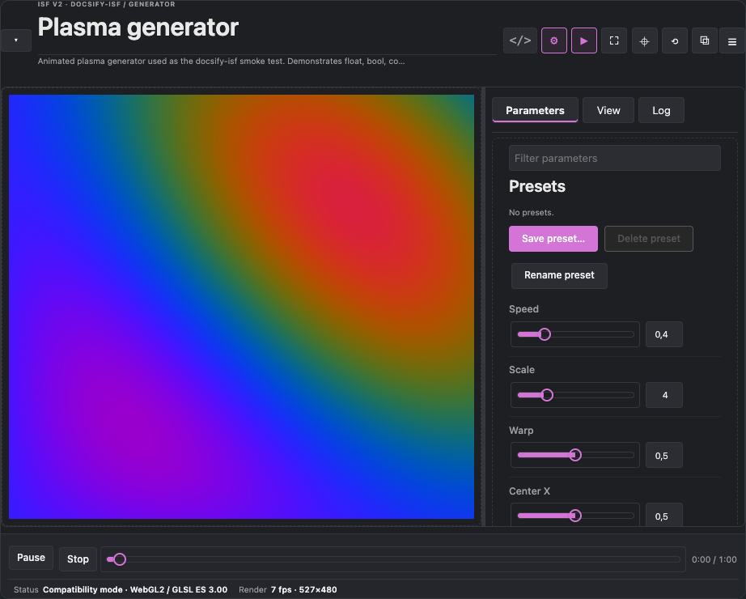 |
| Desktop, Source + Parameters | 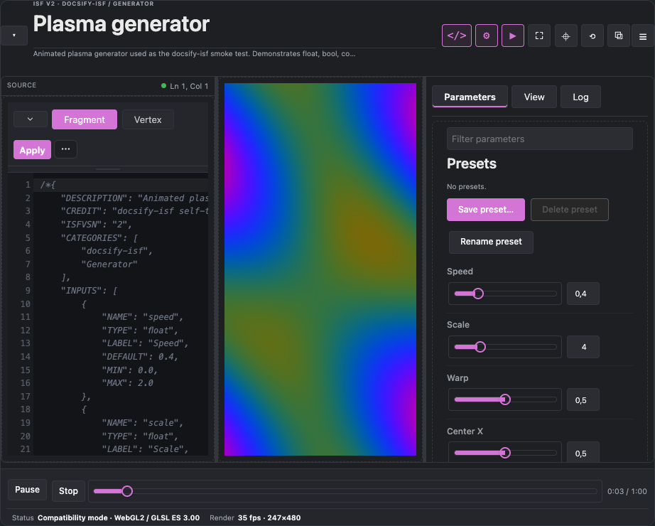 |
| Desktop, View tab | 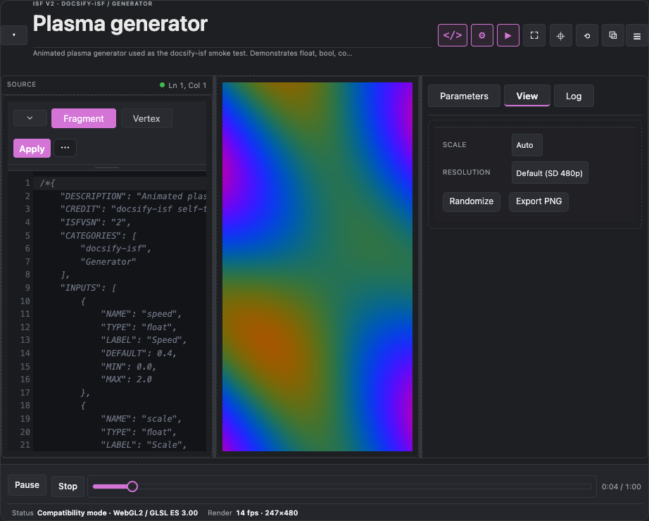 |
| Desktop, saved preset | 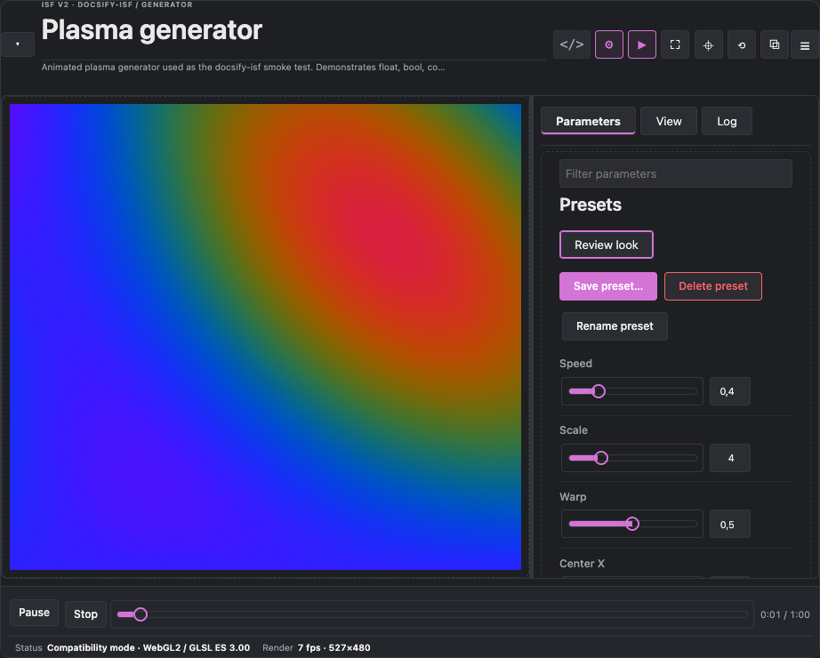 |
| Desktop, command palette | 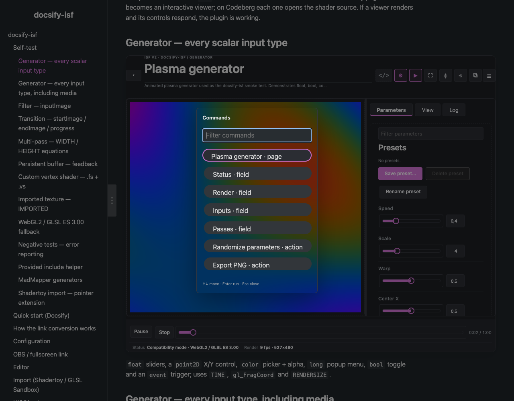 |
| Desktop, title bar compact | 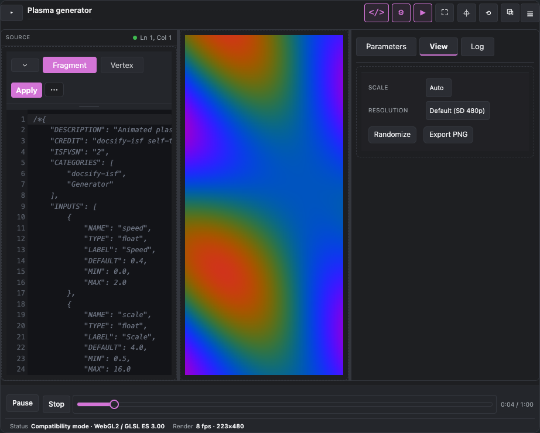 |
| Desktop, shortcuts help | 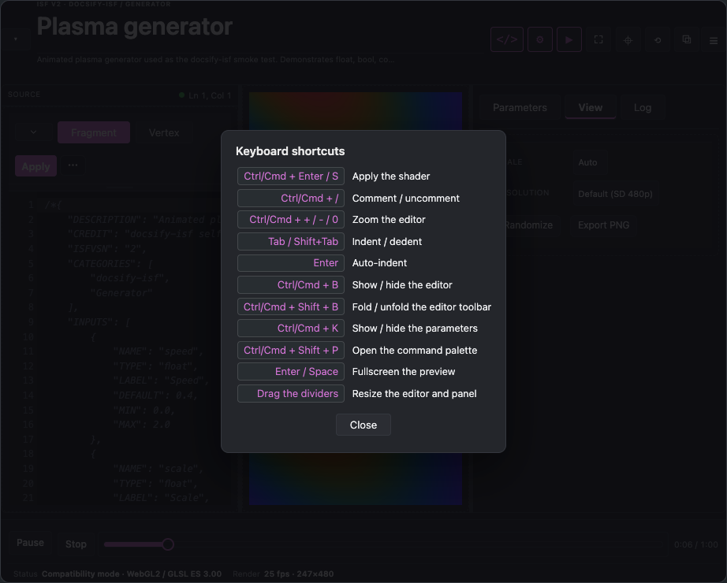 |
| Desktop, Focus preview | 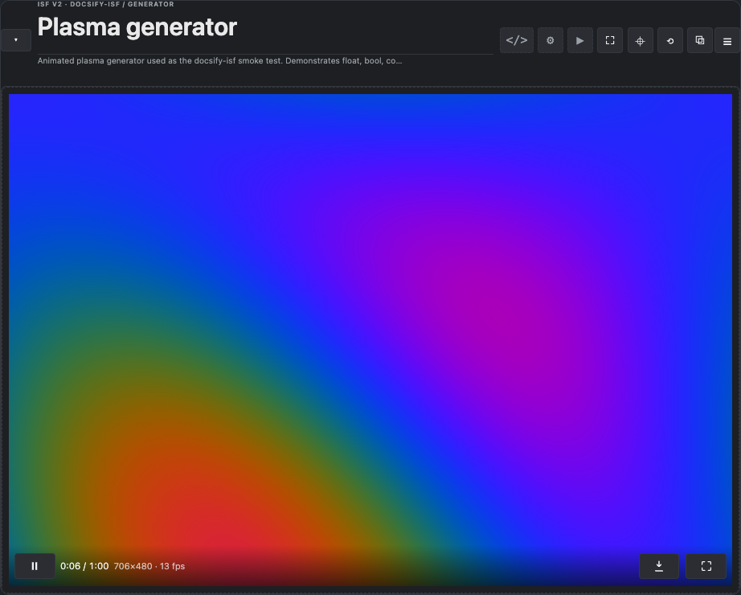 |
| Desktop, fullscreen | 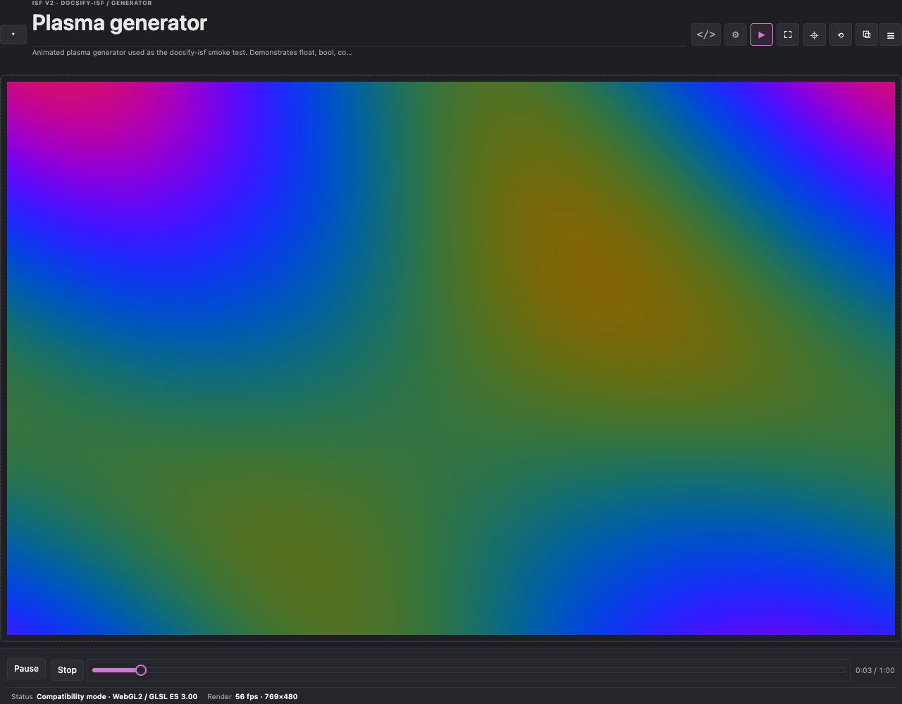 |
| Phone, Parameters | 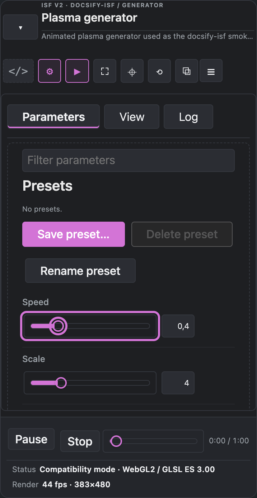 |
| Phone, Source | 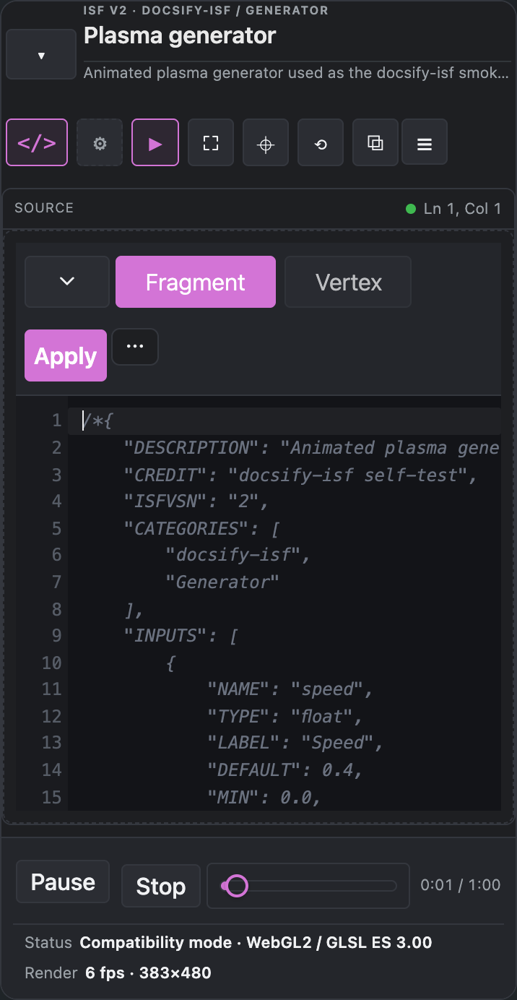 |
| Phone, stage HUD | 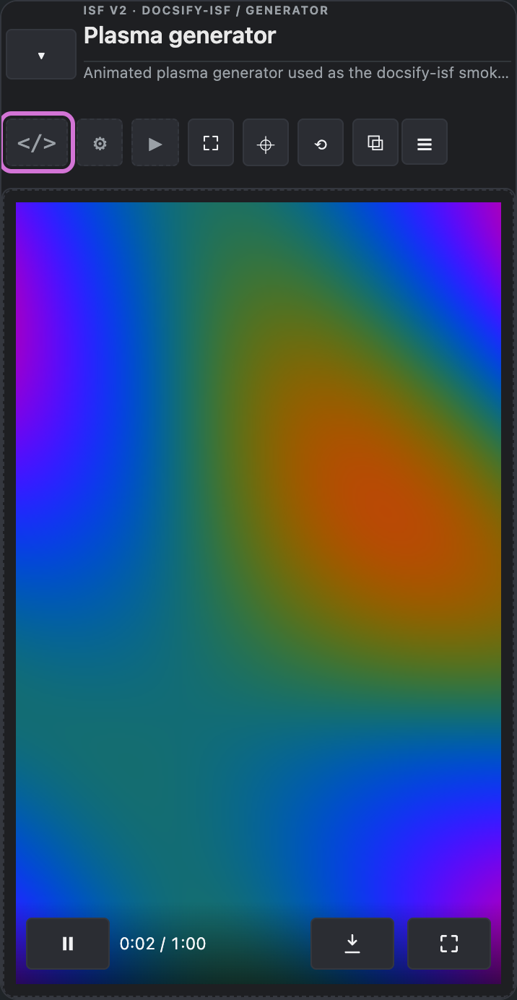 |
| Phone, long-press tooltip | 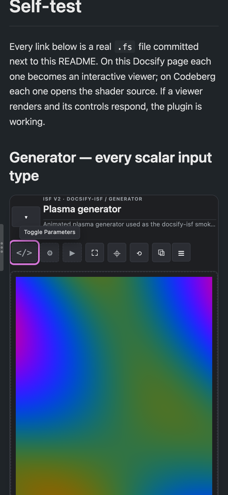 |
| Phone, shortcuts help | 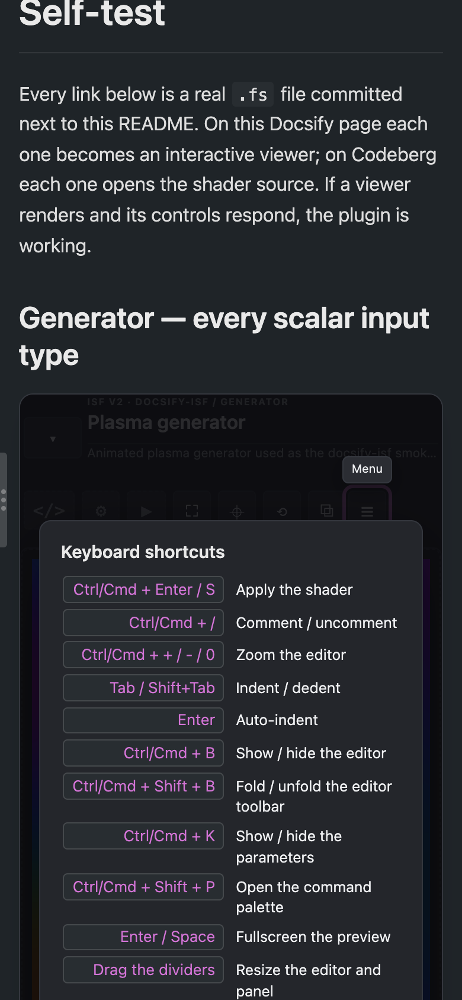 |
| Phone, command palette | 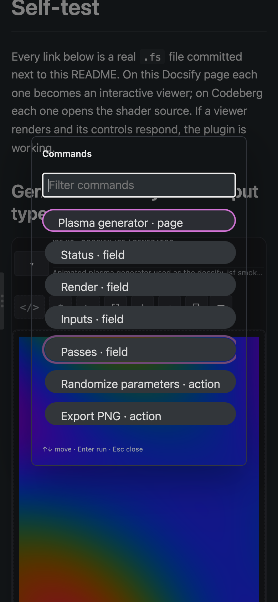 |

The captures are block-level so the workbench chrome, not the Docsify sidebar,
is the subject. The phone captures are 390×844 CSS px; desktop is 1280×1000.

---

## 2. What was hurting

1. **Three competing title levels.** The Docsify page heading, then an
   eyebrow/title/description block, then pane titles and a tab bar. On a 920 px
   content column, the stage was the first thing to lose space.
2. **Redundant labels.** `PREVIEW` above the stage, `PARAMETERS` above a
   `Parameters` tab, and `Source editor` inside a `SOURCE` pane repeated the
   same information.
3. **Mobile title bar density.** At 390 px the title/description and four
   textual controls stacked into a ~192 px header before the workbench body.
4. **Cryptic source state.** Once the editor chrome was hidden, the caret and
   compile status disappeared even though they are the two most useful editor
   signals.
5. **No-op transport controls.** Loop/rate were rendered even when the host
   reported `canLoop:false`/`canRate:false`; the bottom bar looked heavier than
   its actual capability.
6. **Weak section state.** Pane toggles were plain buttons; open/closed state
   was not obvious at a glance, especially when several panes were open.
7. **Search was absent.** Larger ISF materials (8–20 inputs) required scrolling
   instead of filtering, unlike every mature inspector.
8. **Focus was accidental.** The complexity of four panes had no one-step way
   to return to a pure preview.
9. **Toolbar keyboard order was flat.** Every action was a separate tab stop.

---

## 3. Research: what already solves this

| Reference | Technique taken |
|---|---|
| **VS Code workbench** | One compact title/toolbar row; view toggles; panel/status model; roving toolbar/tabs; command palette; content-first editor area. |
| **Blender** | Compact area headers; editor tabs; maximise-area (our Focus preview); panels as headers, not nested title bars. |
| **Figma** | Panel headers with actions; consistent 32 px icon buttons with tooltips; command palette; collapsible panels. |
| **OBS ISF editor** (projection mapping) | Left Inputs/Source, central render, right diagnostics, bottom status; the closest domain-specific layout. |
| **Ark UI / Radix UI** | Toolbar, ToggleGroup, Tabs, Splitter, Collapsible primitives; roving tab stops, `aria-controls`/`aria-expanded`, visible focus. |
| **Dockview / Golden Layout** | Resizable split panes and persisted layout; validates PUI's workbench split-pane model without requiring full docking. |
| **Leva / Theatre.js** | Dense parameter controls, quick reset, filter/search over parameters. |
| **PUI itself** | Workbench regions, collapsible title bar, titlebar eyebrow, pane icons, `search`, transport/statusbar and command palette. |

### Principles selected

- One application chrome, not three title systems.
- Content first: remove labels that the tab/header already carries.
- Progressive disclosure: keep the description, search and details available,
  but not permanently in the primary visual path.
- One primary action per surface (Apply in the editor; Play/Pause in playback).
- Show only controls the host can honour.
- Icons + labels on desktop, icons + accessible names on phones.
- Roving toolbar semantics and visible active states.
- A first-class focus/preview mode.

---

## 4. Implemented changes

### PUI upstream

- Workbench title bar keeps a compact title when collapsed; eyebrow/description
  hide first.
- Phone side drawers use the full workbench width below 520 px; host
  `open_bind` updates obey the same one-drawer-at-a-time rule as the toggles.
- The selected Parameters/View/Log tab has an accent underline instead of
  blending into the inactive tabs.
- Command palette: visible `Commands` title, keyboard hint, only real favorites
  get a star, and filtering to zero results is safe.
- Pane toggles accept decorative icons and visible labels; accessible name is
  `Toggle <pane>`.
- Active pane toggles use the accent state.
- Workbench tools are a `role="toolbar"` with one roving tab stop and
  Arrow/Home/End navigation.
- Coarse-pointer titlebar controls are at least 32 px.
- PUI's parameter filter is available to hosts; docsify enables it for
  materials with six or more inputs.

### docsify host

- Content-first chrome:
  - removed the visible `Preview` label and the duplicate right-pane title;
  - hid the Source editor head inside the Source pane;
  - moved Source caret/status into a compact title-bar dot + `Ln x, Col y`;
  - made `Apply` the editor's primary action.
- Title bar carries the ISF eyebrow, title, description, pane icons/labels and
  the command menu; collapsed state retains the title.
- Mobile title bar uses two rows: identity/description then icon-only controls.
- Playback is a compact strip; transport title and unavailable Loop/rate
  controls are hidden; the statusbar remains.
- **Filter parameters** appears for larger input sets.
- **Menu → Focus preview** closes Source, Parameters and Playback in one step.
- Only one Parameters pane is open across viewers; Source and Parameters have
  explicit show/hide state.
- Shortcuts help is a workbench-level modal (always visible on phone), and the
  editor More menu opens inside the Source pane instead of off its left edge.
- The Menu and More tests scope their item queries to the current workbench;
  selecting an item closes the Menu and executes that viewer's action.
- Fullscreen keeps the compatibility status; auto-open never resets a selected
  tab or steals from an already-open Source pane; pending pane focus is
  cancelled when another pane opens.
- Closing Playback (including Focus preview) reveals a content-first **stage
  HUD** with play/pause, time, resolution/fps, capture and fullscreen. It stays
  for keyboard focus/pause, auto-hides during pointer playback, drops stats
  below 440 px of stage width, and is suppressed for OBS/bare viewers.
- Icon-only chrome now has **hover/focus/long-press tooltips** (PUI 1.15.3):
  titlebar toggles/actions, PUI menus, the host HUD and the fold control. A
  touch long-press shows the label without firing the button; the next pointer
  gesture clears suppression. Tooltips are hosted outside contained PUI roots
  and copy the active theme tokens, so they position correctly in fullscreen.

### Measured result

- Desktop title bar: **~80 px** expanded with a one-line description, **~48 px**
  compact; section/action controls are 32 px high and icon-only.
- Phone title bar: **~121 px** with identity + one icon row (previously ~192 px
  with stacked text controls).
- Phone side pane: **full workbench width** in a one-drawer layout; the stage
  is no longer reduced to a ~30 px sliver. With drawers closed the stage owns
  the workbench body (~457 px at 390×844).
- Source at 280–300 px keeps a `Ln x, Col y` and compile-status indicator
  without spending a full status row.
- Playback strip: **~80 px** desktop / **112 px** phone including the two-line
  statusbar. The Source toolbar stacks a compact tab/fold row over Apply +
  More. The titlebar description is one ellipsized line (full tooltip).
- Stage HUD: **32 px** controls (36 px coarse pointer) over the preview; the
  desktop Focus HUD shows time + `width×height · fps`, while a phone stage
  (356 px) keeps only time + play/capture/fullscreen because stats would
  truncate.

---

## 4.1 Screenshot audit findings (1.41.0)

The second full capture review found and fixed:

1. **Phone panes left a stage sliver** — side panes were 84vw drawers; at 390
   px the remaining stage was ~30 px. PUI now uses 100% width on phones and
   enforces one side drawer for host-driven `open_bind` changes too.
2. **The Playback strip could disappear** — mobile taps were not reliably
   landing and the pane state was not asserted. The touch trace now scrolls
   each toggle into view, taps it, and checks pane width, exclusivity, the
   bottom strip and its `aria-expanded`.
3. **The Focus capture never focused** — the audit clicked a non-existent
   header-menu item. It now invokes the direct titlebar focus action.
4. **The editor More menu ran off the left edge** — its popup was right-aligned
   to a 30 px trigger; it now opens into the pane, scoped and measured.
5. **Help was trapped in the stage** — the shortcut grid was clipped in a
   270 px stage. Help is now a scrollable workbench modal at both widths.
6. **The menu test clicked another viewer's items** — global `.pui-actions`
   queries were replaced with block-scoped queries; help opens and the menu
   closes after the action.
7. **Selected pane tabs were nearly invisible** — PUI now draws an accent
   underline and stronger weight on the active tab.
8. **Fullscreen showed a blank `Status` label** — the compatibility status is
   retained.
9. **Focus could be stolen by a pane closing as a side effect** — pending
   toggle focus is cancelled when the newly opened pane takes focus.
10. **Auto-open could reset a user-selected tab** — it now no-ops when the
    inspector or Source is already open.
11. **Stale drawer/inspector/template CSS** was removed after the workbench
    migration.

## 4.2 Stage HUD (1.42.0)

- The HUD appears only while Playback is closed, so it never duplicates the
  full transport. Focus preview closes Playback and peeks the HUD for 1.7 s.
- Controls: play/pause, elapsed/total time, resolution/fps, PNG capture,
  fullscreen. All buttons stop the stage double-click handler.
- Pointer movement/enter/down reveals it; a 1.9 s timer hides it during
  playback. It stays while the stage or HUD has keyboard focus and whenever
  playback is paused.
- It is hidden until the runtime is live, unavailable with Playback open, and
  suppressed in bare/OBS mode. The stats are hidden by a stage container query
  under 440 px so phone buttons do not truncate.

## 4.4 Parameter presets

- PUI's existing `presets`/`storage` contract is adopted for named looks. The
  host owns the values and localStorage; PUI owns the list, Save/Rename name
  forms, Select-to-recall and Delete confirmation.
- Stored at `docsify-isf:presets:<shader-url>` as
  `{presets:[{id,label,values}],selected}`. Media, audio and event inputs are
  intentionally excluded. `persistValues:false` (OBS/bare) disables the store;
  `presets:false` hides the feature.
- Two mounted viewers of the same shader receive a synchronized preset list
  (not each other's live values) without a reload.
- Captures: `desktop-presets.png`; the interaction trace covers the save name
  form, value change, recall, rename name form and label update, delete
  confirmation and removal.

## 4.6 CI popover geometry (1.44.3)

- A CI-only failure exposed that the editor More popover could be measured
  while the Source drawer was collapsed (zero width). The popover is now
  anchored to its trigger (`position:relative`), and the interaction trace
  asserts the Source pane is open before measuring its bounds.
- Rule: pane-relative bounds are only meaningful when the pane is open; tests
  must check the host state first, especially in narrow one-pane layouts.

## 4.5 Tooltips (1.15.2)

- One delegated manager per PUI mount; flagged controls carry
  `data-pui-tooltip`. Hover 320 ms, focus immediate, touch long-press 450 ms.
- A long press suppresses the release click; the next non-touch pointer press
  clears suppression so a mouse/pen click after a touch tooltip is not
  swallowed.
- Tooltips are hosted on the document body, or the fullscreen element while
  fullscreen is active, and copy the active PUI surface/text/font tokens.
  Position is viewport-clamped and above/below the trigger.
- Escape, scroll, focus-out and a 1.6 s touch timeout dismiss; the original
  `title` is restored.
- Captured at phone width on the titlebar Parameters toggle; the HUD variant is
  covered by the interaction trace.

## 4.3 Runtime cost controls

- Workbench state changes are **coalesced to one PUI apply per animation frame**;
  the badge and transport no longer trigger separate applies.
- The editor **More menu is mounted lazily** when Source first opens; a page
  with many viewers otherwise pays for hidden PUI menus.
- Pane state is host-bound through PUI `open_bind`, removing click-listener
  mirroring and its extra state work.
- PUI palette shortcuts are host-scoped to one active viewer, so a page with
  many workbenches never opens multiple palettes.
- Bare/OBS viewers opt out of parameter persistence entirely.
- Initial lazy mount measured **2 PUI workbenches / 4 PUI roots**, with no open
  More menus; off-screen viewers mount only when scrolled into view.

## 5. Remaining opportunities

- **Parameter groups** need a portable ISF/host group contract; no bundled
  shader carries `GROUP`, so the presets block is the current large-material
  affordance instead of invented arbitrary sections.
- **Dockable layout**: Dockview-style docking is unnecessary for the current
  two-pane model; PUI's split panes and focus mode cover it. Revisit only if
  third panes or user-arranged layouts become a requirement.
- **Parameter groups** and saved parameter presets for very large materials.

---

## 6. Reproduce

```bash
node tools/ui-audit.mjs
# captures are written to docs/ui-audit/
```

The script uses Puppeteer/Chrome from `node_modules`; pass `--chrome PATH` or
set `CHROME_PATH` when Chrome is not in the default macOS location.
